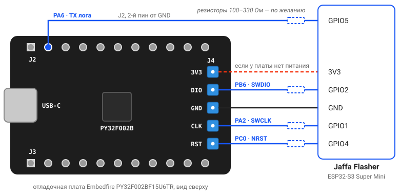

# Jaffa Flasher

Программатор для микроконтроллеров **PY32** (сейчас — PY32F002B) на плате **ESP32-S3 Super Mini**.
Шьёт чип по SWD прямо из браузера: открыли страницу, выбрали файл `.hex`, нажали «Прошить». Не
нужны ST-Link, pyOCD, паки Puya, драйверы и среда разработки. Через тот же USB-порт виден лог
платы.

**Страница прошивки:** <https://waterius.github.io/jaffa_flasher/> — Chrome или Edge на компьютере.



## Как прошить плату

### 1. Прошить ESP32-S3

Один раз: залить в ESP32-S3 прошивку программатора.

Скачать **[jaffa_flasher-esp32s3.bin](https://github.com/waterius/jaffa_flasher/releases/latest/download/jaffa_flasher-esp32s3.bin)**
(все версии — [Releases](https://github.com/waterius/jaffa_flasher/releases)).

1. Зажать **BOOT** на ESP32-S3 и вставить USB — плата войдёт в загрузчик.
2. В Chrome или Edge открыть <https://espressif.github.io/esptool-js/> → **Connect**, выбрать порт
   платы → адрес `0x0`, файл `jaffa_flasher-esp32s3.bin` → **Program**.
   Или из консоли: `esptool --chip esp32s3 write-flash 0x0 jaffa_flasher-esp32s3.bin`.
3. Вынуть и вставить USB — появится порт программатора.

### 2. Подключить провода — по картинке выше

| ESP32-S3 Super Mini | Плата с PY32 | Как |
|---|---|---|
| GPIO1 | SWCLK (PA2) | *через резистор 100–330 Ом* |
| GPIO2 | SWDIO (PB6) | *через резистор 100–330 Ом* |
| GPIO4 | NRST (PC0) | *через резистор 100–330 Ом* |
| GPIO5 | TX лога платы (на отладочной плате — PA6) | *через резистор 100–330 Ом* |
| GND | GND | всегда |
| 3V3 | 3V3 | **только** если у платы нет своего питания |

Резисторы *по желанию*: без них тоже работает, а с ними ноги чипа и ESP32-S3 переживут ошибку в
проводах или спор за линию. Плата должна питаться от **3,0–3,6 В**: при другом питании нужен
преобразователь уровней.

### 3. Прошить со страницы

1. Открыть <https://waterius.github.io/jaffa_flasher/>, нажать **«Подключить»** и выбрать порт
   программатора. Первый раз выбрать чип `py32f002b` → «Выбрать».
2. **«Выбрать файлы…»** — прошивка Intel HEX (из PlatformIO: `.pio/build/<env>/firmware.hex`) и,
   если нужно, файл для USER OTP. Адреса записи берутся из самих файлов.
3. **«Прошить».** Программатор пишет, сверяет каждую страницу и показывает итог, затем — первые
   строки лога платы.

На странице же — терминал с логом платы (скорость, формат UART, метка времени, пауза), команды
программатора и чтение памяти чипа. Файлы не покидают браузер.

Подробности и ограничения страницы:
- в Firefox, Safari и на телефонах Web Serial нет — нужен Chrome или Edge на компьютере;
- перед подключением закрыть `pio device monitor` и gdb — порт открывает одна программа;
- «Стереть всю основную flash перед записью» убирает данные прошлых прошивок; USER OTP не стирается;
- страница отказывается до записи, если в файле ошибка, адрес вне памяти чипа или два файла задают
  одному адресу разные байты; файл с замком USER OTP отвергается;
- обрыв USB посреди записи оставляет плату недописанной — прошить ещё раз;
- без сети: `python3 -m http.server -d docs 8000` и `http://localhost:8000/` (из `file://` Web
  Serial не работает).

## Прошивка из PlatformIO

Программатор отвечает gdb как отладчик Black Magic Probe, поэтому PlatformIO шьёт через него
штатно. В `platformio.ini` проекта платы:

```ini
upload_protocol = blackmagic
upload_port = COM5            ; обязателен. macOS: /dev/cu.usbmodem…; COM10 и дальше: \\.\COM10
```

```sh
pio run -t upload       # прошить
pio device monitor      # итог программатора и лог платы
```

Чип выбирается один раз командой `chip py32f002b` в мониторе порта (или на странице) и хранится в
программаторе.

## USER OTP из gdb

gdb лежит в тулчейне PlatformIO: `~/.platformio/packages/toolchain-gccarmnoneeabi/bin/arm-none-eabi-gdb`
(на Windows — тот же путь в `%USERPROFILE%`, с `.exe`). Файл Intel HEX с адресами `0x1FFF0280`…
`0x1FFF02FF`:

```sh
arm-none-eabi-gdb -nx --batch -ex "target extended-remote COM5" -ex "monitor swdp_scan" \
  -ex "attach 1" -ex "load otp.hex" -ex "kill"
```

Прошивку и OTP можно залить одним сеансом — два `load` подряд. Прочитать память — `x/32xw
0x1FFF0280`, а сеанс без записи закрывать `detach`, не `kill`: `kill` без записи программатор считает
провалом, чтобы PlatformIO увидел ошибку.

- Программатор **никогда не ставит замок OTP** (`0xAA55` в битах 15:0 слова `0x1FFF0280`): файл с ним
  отвергается, плата не тронута.
- Совет: держите биты 15:0 слова 0 USER OTP равными `0xFFFF`. Тогда замок не возникнет даже при
  обрыве питания посреди записи.

## Команды

Строкой в мониторе порта или `monitor <команда>` в gdb:

| Команда | Что делает |
|---|---|
| `help` | список команд |
| `chip [имя]` | выбрать чип; без имени — выбранный и поддержанные. Перечисляет записываемые области чипа: `# область 0x1FFF0280–0x1FFF02FF: USER OTP` |
| `info` | подключиться и показать способ подключения, `IDCODE`, UID, HSI; перезапускает плату |
| `erase` | стереть всю основную flash и проверить `0xFF`; USER OTP не трогает. Вне сеанса gdb перезапускает плату |
| `reset` | перезапустить плату импульсом NRST |
| `baud [скорость [формат]]` | лог платы: скорость 1 200–2 000 000 и формат кадра — биты 5–8, чётность `N`/`E`/`O`, стоп 1 или 2, например `baud 9600 8E1`; до перезапуска программатора, по умолчанию 115 200 8N1 |
| `swdp_scan` | только в gdb: подключиться и назвать чип |

Строки программатора начинаются с `# `, всё остальное — лог платы. Эхо программатор не делает — в мониторе
включите `monitor_echo = yes`.

## Ограничения

- Поддержан один чип — PY32F002B.
- Байты страницы 128 Б, которых нет в образе, после записи — `0xFF`. Страницы вне образа не
  трогаются, пока не дана команда `erase`.
- `erase` при защите записи (WRP) не стирает ничего: «полное стирание невозможно: защита записи».
- Защищённые от записи страницы (WRP) программатор не снимает: запись остановится на первой из них.
- HSI платы не 24 МГц — отказ «снимите питание платы»: NRST частоту не сбрасывает.
- Отладки нет: `continue`, шаги и точки останова gdb получит с ошибкой.
- Сеанс gdb без пакетов 60 с завершается, плата запускается.
- На macOS порт может открыть второй процесс: открытый монитор во время заливки делит байты с gdb.
- Открытие порта на скорости 1 200 перезагружает программатор в загрузчик ESP.
- Если программатор потерял питание посреди сеанса, а плата питается сама, ядро платы стоит, пока на
  плате не пропадёт питание или не выполнится `info`.

## Сборка программатора из исходников

```sh
pio run -e esp32s3 -t upload   # собрать и залить по USB самого программатора
pio test -e native             # тесты на ПК
```

Первая заливка, обновление без кнопок и порты в macOS и Windows — [`firmware_flasher.md`](firmware_flasher.md).
Своя заводская страница поверх модулей страницы прошивки — [`product_page.md`](product_page.md).

> Статус: проверено на плате на macOS (`dev/board-checks.md`, `dev/board-checks-web.md`); Windows и
> запись USER OTP на плате ещё не проверены.

## Устройство

Требования — `openspec/specs/`. Решения — `openspec/changes/archive/2026-11-13-swd-flash-py32f002b/` (design §1–§12), страница
прошивки и `erase` — `openspec/changes/archive/2026-11-13-web-flash-page/` и `…-jaffa-flasher-page/`, правила для
разработчика — `CLAUDE.md`, первоисточники — `datasheets/README.md`.
